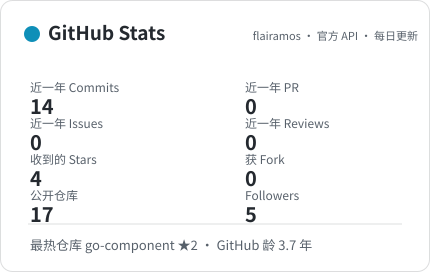
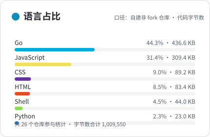
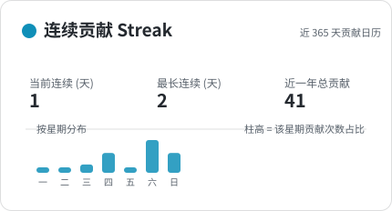
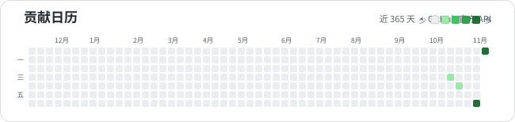

<!--
  ═══════════════════════════════════════════════════════════════
  GitHub Profile README — flairamos · 后端开发（Go / Java）
  ═══════════════════════════════════════════════════════════════
  ▸ 统计类卡片（GitHub Stats / 语言占比 / Streak）不再依赖
    github-readme-stats 等第三方实例，而由本仓库自带方案生成：
      scripts/generate_stats.py        基于 GitHub 官方 API 的数据分析与 SVG 渲染
      .github/workflows/update-stats.yml   每天北京时间 09:05 自动刷新
      assets/stats.json                每轮分析输出的原始指标（可自查）
  ▸ 卡片统一放本仓库 assets/ 下，README 用相对路径引用 —— 只要是能打开
    github.com 页面的网络环境就一定能加载出来（no vercel.app / no 被墙域名）。
  ▸ 亮/暗主题用 <picture> 自适应，跟随访问者的 GitHub 主题。
  ▸ 首次启用 / 本地运行 / 私有仓库统计：见 docs/PROFILE.md
  ═══════════════════════════════════════════════════════════════
-->

<div align="center">


<br/>

<!-- 若打字动画在某网络环境下加载不出，可换为仓库内静态版 assets/tagline.svg -->
<a href="https://git.io/typing-svg">
    
  </a>

<br/>


  
  
  

</div>

<br/>

## ▸ About

```console
$ whoami
$
$   后端开发工程师 · 3 年经验
$   第一年写 Java，后两年写 Go，现在主要在 Go 生态里做微服务
$
$   相信"能跑"只是及格线，可维护性才是长期价值。
$   喜欢读源码、抠性能、把复杂的东西写成简单的样子。
$   业余时间会翻翻 CNCF 的项目，偶尔给开源提提 issue。
$
$ cat philosophy.txt
$
$   Simplicity is a feature.
$   Make it work → make it right → make it fast.
$
$ exit
```

<br/>

## ▸ Career Path

```text
2021 ─ 2022   ▸ Java Backend
              Spring Boot · MyBatis · MySQL · Redis
              从 0 建立工程认知：分层、事务、SQL 调优

2022 ─ 2023   ▸ Go Backend
              Gin · gRPC · Protobuf · Docker · K8s
              切换到高并发场景：goroutine 模型与云原生工具链

2023 ─ now    ▸ Go Backend / 服务治理
              微服务拆分 · 链路追踪 · 性能优化 · 稳定性建设
              开始对"系统怎么坏掉"比对"功能怎么写"更感兴趣
```

> 不出意外我应该还没把这些知识忘完。

<br/>

## ▸ Tech Stack

<div align="center">

<p align="center">
    <a href="https://skillicons.dev">
      
    </a>
  </p>

<table>
    <tr>
      <td align="center"><b>主力语言</b></td>
      <td>
        
        
        
      </td>
    </tr>
    <tr>
      <td align="center"><b>服务框架</b></td>
      <td>
        
        
        
        
        
      </td>
    </tr>
    <tr>
      <td align="center"><b>存储 / 中间件</b></td>
      <td>
        
        
        
        
        
      </td>
    </tr>
    <tr>
      <td align="center"><b>云原生 / 运维</b></td>
      <td>
        
        
        
        
        
      </td>
    </tr>
    <tr>
      <td align="center"><b>可观测性</b></td>
      <td>
        
        
        
        
      </td>
    </tr>
  </table>

</div>

<br/>

## ▸ Featured Projects

<div align="center">

<table>
    <tr>
      <td width="50%" align="left">
        <b><a href="https://github.com/flairamos/jt808-2019-gateway">jt808-2019-gateway</a></b>
        
        <br/>
        <sub>车联网国标 JT/T 808-2019 协议解析网关，报文校验内置，面向高并发接入场景。</sub>
      </td>
      <td width="50%" align="left">
        <b><a href="https://github.com/flairamos/lovewall">lovewall</a></b>
        
        <br/>
        <sub>校园表白墙 · 晒日常 · 跳蚤市场一体化项目，正在写的新坑 ⏳</sub>
      </td>
    </tr>
    <tr>
      <td width="50%" align="left">
        <b><a href="https://github.com/flairamos/ginserve">ginserve</a></b>
        
        <br/>
        <sub>基于 Gin 的服务脚手架：分层路由、中间件封装、统一异常与响应。</sub>
      </td>
      <td width="50%" align="left">
        <b><a href="https://github.com/flairamos/go-component">go-component</a></b>
        
        <br/>
        <sub>常用 Go 组件集合：把每次生产环境用到的轮子沉淀下来。</sub>
      </td>
    </tr>
    <tr>
      <td width="50%" align="left">
        <b><a href="https://github.com/flairamos/awesome-skills">awesome-skills</a></b>
        <br/>
        <sub>把工作里踩过的坑沉淀成"技能手册"，持续更新。</sub>
      </td>
      <td width="50%" align="left">
        <b><a href="https://flairamos.github.io">flairamos.github.io</a></b>
        <br/>
        <sub>个人博客：技术笔记与思考，正在持续搬家填充中。</sub>
      </td>
    </tr>
  </table>

↗ 更多项目见 [repositories](https://github.com/flairamos?tab=repositories)：goutil、fiberserve、filebrowser-api 等。

</div>

<br/>

## ▸ What I'm Doing

```text
▸ 正在深入   服务网格与流量治理，以及 Go 运行时的调度细节
▸ 正在做     lovewall —— 把校园社区的小需求做成一个可靠的集成项目
▸ 想参与     国内 Go 方向的开源项目，尤其是 CLI 与基础设施类
▸ 在学       Rust —— 想理解所有权模型对架构思维的影响
▸ 欢迎问我   Go 并发模式、微服务拆分边界、慢查询排查
▸ 一句话     我更喜欢读别人的好代码，而不是写自己的炫代码
```

<br/>

## ▸ GitHub Stats

<div align="center">

<!-- 以下卡片由本仓库 GitHub Actions 调用官方 API 自动生成，相对路径引用，永不 失效/被墙。
     数据接口：REST /users/{login} + GraphQL contributionsCollection & repositories.languages -->

<p>
    <picture>
      <source media="(prefers-color-scheme: dark)" srcset="assets/stats-dark.svg" />
      <source media="(prefers-color-scheme: light)" srcset="assets/stats-light.svg" />
      
    </picture>
    <picture>
      <source media="(prefers-color-scheme: dark)" srcset="assets/languages-dark.svg" />
      <source media="(prefers-color-scheme: light)" srcset="assets/languages-light.svg" />
      
    </picture>
  </p>

<p>
    <picture>
      <source media="(prefers-color-scheme: dark)" srcset="assets/streak-dark.svg" />
      <source media="(prefers-color-scheme: light)" srcset="assets/streak-light.svg" />
      
    </picture>
  </p>

📊 数据明细（原始指标）见 [assets/stats.json](assets/stats.json)，每天北京时间 09:05 自动更新。

</div>

<br/>

## ▸ 贡献日历 · Contribution Calendar

<!-- 贡献日历：scripts/generate_stats.py 用官方 GraphQL contributionCalendar 渲染，
     带星期/月份坐标与图例（贪吃蛇动画本身没有坐标轴，二者正好互补）。
     若图片缺失：重跑一次 Update Profile Stats 生成 assets/calendar-*.svg -->
<div align="center">
  <picture>
    <source media="(prefers-color-scheme: dark)" srcset="assets/calendar-dark.svg" />
    <source media="(prefers-color-scheme: light)" srcset="assets/calendar-light.svg" />
    
  </picture>
</div>

<br/>

## ▸ 贡献贪吃蛇 · Snake

<!-- 动效彩蛋：由 snake.yml 生成并提交进 assets/，缺失时重跑 Generate Contribution Snake -->
<div align="center">
  <picture>
    <source media="(prefers-color-scheme: dark)" srcset="assets/snake-dark.svg" />
    <source media="(prefers-color-scheme: light)" srcset="assets/snake-light.svg" />
    
  </picture>
</div>


<br/>

## ▸ Find Me

<div align="center">

<a href="https://github.com/flairamos">
    
  </a>
  <a href="https://flairamos.github.io">
    
  </a>
  <a href="mailto:you@example.com">
    
  </a>
  <a href="https://x.com/flairamos">
    
  </a>
  <a href="https://juejin.cn/user/your-user-id">
    
  </a>

</div>

<br/>

---

<div align="center">

```console
$ uptime   →   写代码.undo.rollback.redesign，最后还是 ship 之日最快乐
$ others   →   "先跑起来再说"      $ me       →   "先回归测试再说"
```

<br/><br/>


</div>
